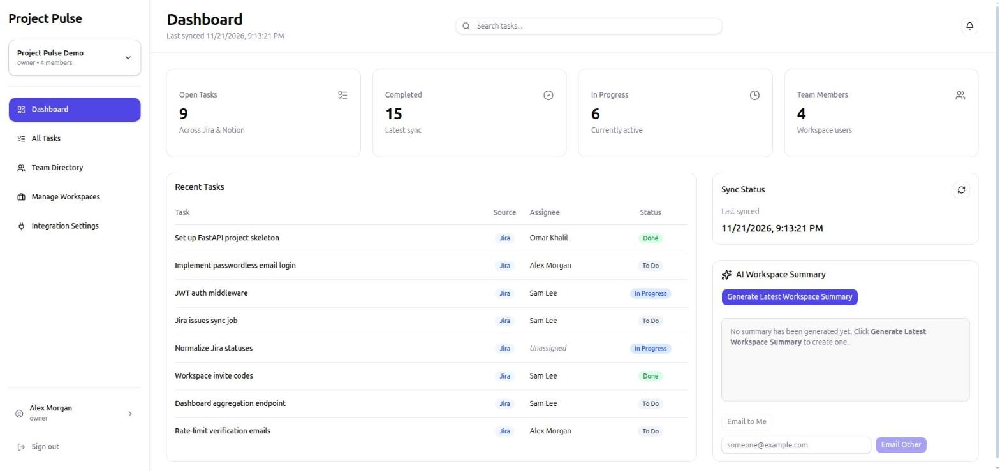
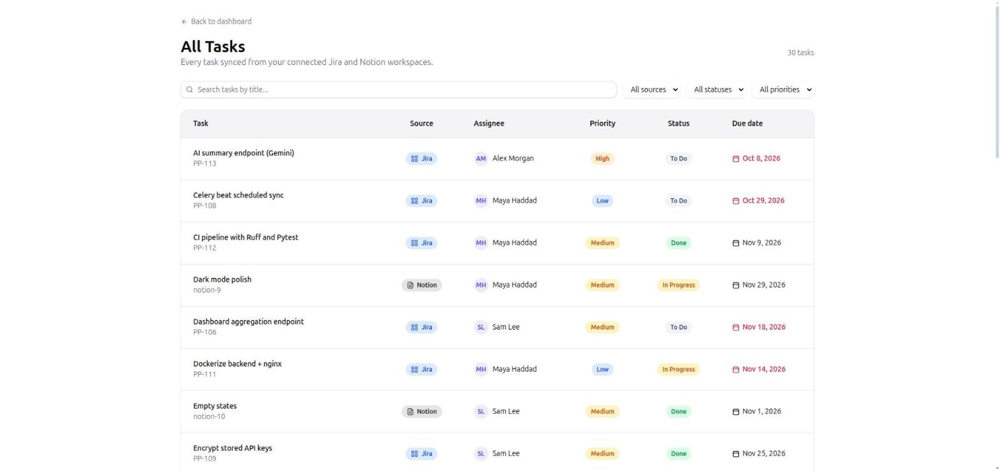
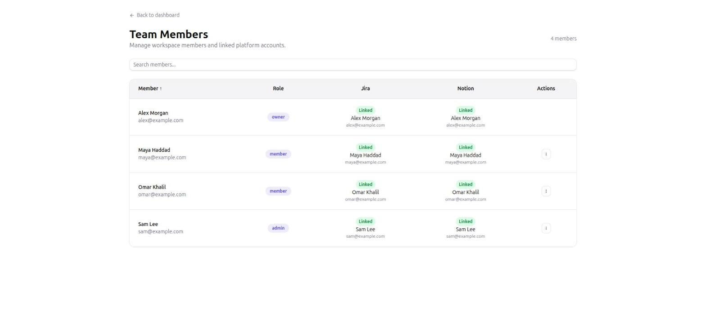
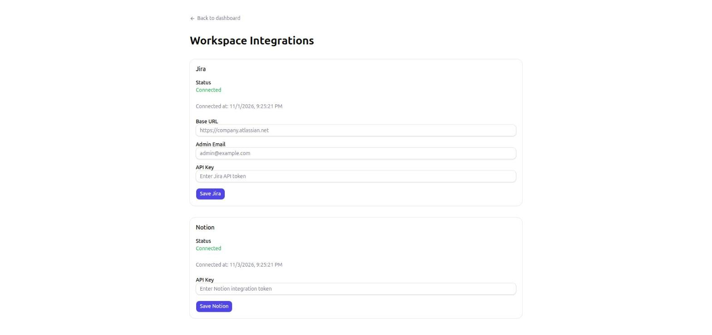
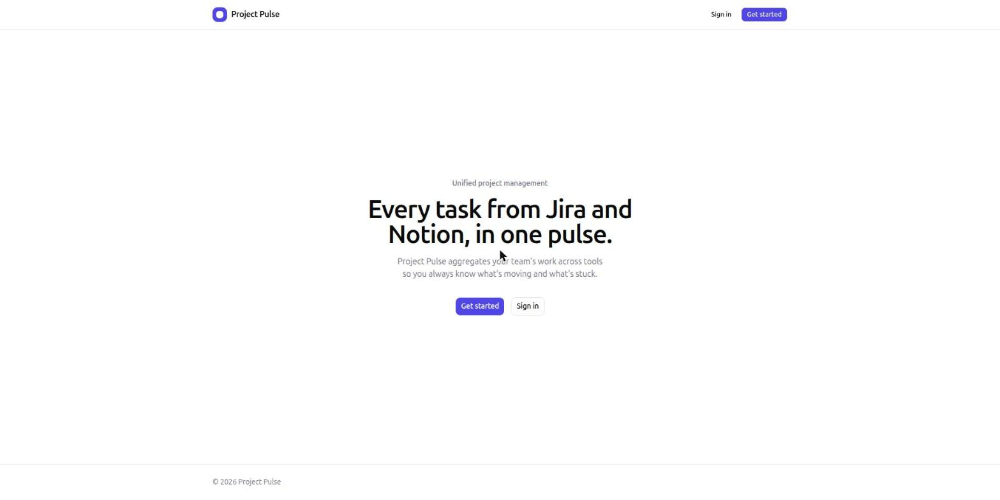

# Techtalks Project Pulse

[](https://github.com/yousseff907/Techtalks-project-pulse/actions/workflows/ci.yml)

> A Jira and Notion analytics dashboard, built as an internship project in the TechTalks Lebanon program.

---

## About the project

Project Pulse pulls tasks, projects, and team members from Jira and Notion through their REST APIs, converts them into one internal schema, and shows them on a single dashboard. Teams can follow their progress across both tools without switching between them.

---

## The problem it solves

When a team splits its work between Jira and Notion, nobody has one view of it. Someone has to check both tools and put status reports together by hand, and work tracked in one tool is easy to miss from the other. Project Pulse syncs both into one place and does the counting automatically.

---

## Features

- Jira and Notion integration that normalizes tasks, projects, and users from both platforms into one schema
- Automatic sync of every workspace every 30 minutes with Celery beat, plus a manual sync for workspace owners and admins
- Dashboard with task counts by status, recent tasks, and sync status; the dashboard API also calculates completion rate and workload per assignee
- Task table with search and filters by source, status, and priority
- Team directory that matches workspace members to their Jira and Notion accounts by email or name
- AI workspace summaries generated with Google Gemini, which can be emailed to yourself or anyone else
- Passwordless login with emailed verification codes
- Multiple workspaces per user, each with its own integrations, invite code, and member roles

---

## Screenshots

The screenshots use sample demo data.



| All tasks | Team members |
|-----------|--------------|
|  |  |

| Integrations | Landing page |
|--------------|--------------|
|  |  |

---

## Planned features

- Scheduled daily reports by email, and possibly WhatsApp

---

## Tech stack

| Layer | Technology |
|-------|-----------|
| Frontend | Next.js, React, TypeScript, Tailwind CSS |
| Backend | FastAPI (Python) |
| ORM | SQLAlchemy |
| Database | PostgreSQL |
| Background jobs | Celery, Redis |
| AI summaries | Google Gemini |
| Email | Resend |
| Infrastructure | Docker, Nginx |
| CI/CD | GitHub Actions |
| Data sources | Jira REST API, Notion REST API |

---

## Getting started

You need Docker with Docker Compose, and `make`.

```bash
git clone https://github.com/yousseff907/Techtalks-project-pulse.git
cd Techtalks-project-pulse
cp .env.example .env    # fill in the secrets and API keys
make up-build
```

The app runs at <http://localhost>, and the API docs at <http://localhost/api/docs>.

| Command | What it does |
|---------|--------------|
| `make up` | Start all services |
| `make down` | Stop all services |
| `make logs` | Follow logs from all services |
| `make clean` | Stop services and delete the database volume |
| `make backend-shell` | Open a shell in the backend container |
| `make db-shell` | Open `psql` in the database container |

### Running tests

```bash
pip install -r backend/requirements.txt
pytest backend/tests/    # needs a Postgres at localhost:5432 (user/pass/db: testuser/testpass/testdb)
```

---

## Team

Built by Team Python D during the TechTalks internship program.

- [Youssef Itani](https://github.com/yousseff907) (Team Lead)
- [Paul Riachy](https://github.com/PaulRiachy)
- [Abbas Abed Al Nabi](https://github.com/Abbas-an)
- [Nour Al Zahraa Hammoud](https://github.com/nhh0050-cell)

Mentor: [Khaled Frayji](https://github.com/khaledfrayji)

---

## Sprint reports and documentation

- Sprint 1 Report: [Notion Link](https://tasteful-persimmon-4c2.notion.site/Sprint-1-Report-39431913a1a180cbb7a8f8c414ba8201?source=copy_link)
- Sprint 2 Report: [Notion Link](https://tasteful-persimmon-4c2.notion.site/Sprint-2-Report-39331913a1a18048bf17d8f8496b478f?source=copy_link)
- Sprint 3 Report: [Notion Link](https://tasteful-persimmon-4c2.notion.site/Sprint-3-Report-39a31913a1a180379a8bd5352aea278b?source=copy_link)
- Sprint 4 Report: [Notion Link](https://tasteful-persimmon-4c2.notion.site/Sprint-4-Report-3a131913a1a18020b875f53e05d524cc?source=copy_link)
- Sprint 5 Report: [Notion Link](https://tasteful-persimmon-4c2.notion.site/Sprint-5-Report-3a931913a1a1806ca8d1d87cc23650e7?source=copy_link)
- SRS / Documentation: [Notion Link](https://tasteful-persimmon-4c2.notion.site/Project-Pulse-Software-Engineering-Documentation-38431913a1a180019af3d43f4b80e74d)
- Development Workflow: [Notion Link](https://tasteful-persimmon-4c2.notion.site/Development-Workflow-38831913a1a18035870dedf9dc77c782)

---

## API documentation

FastAPI generates interactive API docs from the route definitions, so they always match the code. With the stack running (`make up`), open:

- Swagger UI: <http://localhost/api/docs>
- ReDoc: <http://localhost/api/redoc>

---

## License

Released under the [MIT License](LICENSE).
